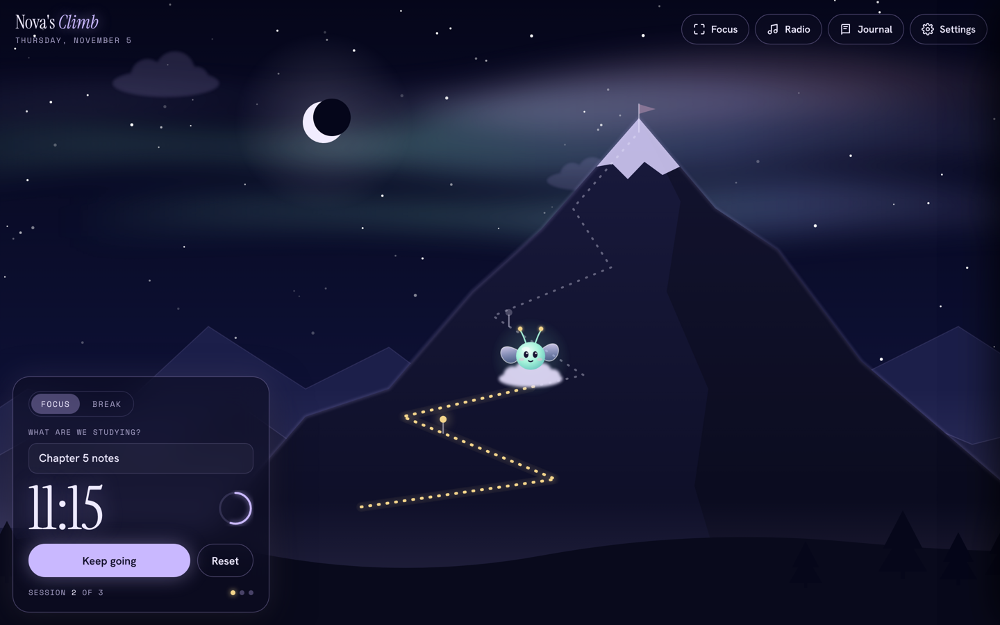

# Nova's Climb

A study companion. Nova, a little alien-fairy on a cloud, climbs a starlit mountain as you finish focus sessions.

The sky follows the real time of day, and a built-in radio plays music that the app makes itself.

## Features
- **Focus timer** with focus and break modes, custom lengths and a daily goal. Each finished session lights a lantern on the trail; reach your goal and Nova hits the summit.
- **Nova** has moods and a personality: reads a tiny book while you focus, dances after a session, naps if you wander off, and talks to you along the way.
- **Living sky** that follows the real time of day: dawn, violet afternoon, sunset, then stars and an aurora.
- **Nova radio**: four stations (Midnight Pages, Rainy Window, Campfire, Aurora) plus rain and fire sounds, all generated live with the Web Audio API. No audio files.
- **Focus mode** that hides everything except the mountain, Nova and the timer.
- **Trail journal**: minutes, sessions, day streak, a 7-day view and a log of what you studied.
- **Installable and offline**: add it to your iPad or laptop home screen; it runs without internet.

## Built with
Plain HTML, CSS and JavaScript. SVG for the scene and character, the Web Audio API for all music and sound,
a web app manifest and service worker for install and offline support. No frameworks, no build step, no server.

## Files
- `index.html`: the whole app
- `manifest.webmanifest`: app name, colours and icons (what makes it installable)
- `sw.js`: keeps a copy of the app on your device so it works offline
- `icon-*.png`, `apple-touch-icon.png`, `icon.svg`: app icons
- `*.woff2`: the three fonts, bundled so nothing loads from the internet

## Put it online (Vercel)
1. Create a new GitHub repository called `nova`.
2. Upload every file in this folder (there are no subfolders).
3. At vercel.com/new, import the `nova` repository. Framework preset: Other. Click Deploy.

## Install it
- **iPad / iPhone (Safari):** open the site, tap Share, then Add to Home Screen.
- **Laptop (Chrome or Edge):** open the site and click the install icon at the right end of the address bar.

## Updating
Upload the changed files to GitHub, and change `VERSION` at the top of `sw.js` (for example `nova-v2`)
so installed copies download the new version.

Your sessions and settings are saved on each device, in the browser you use.
